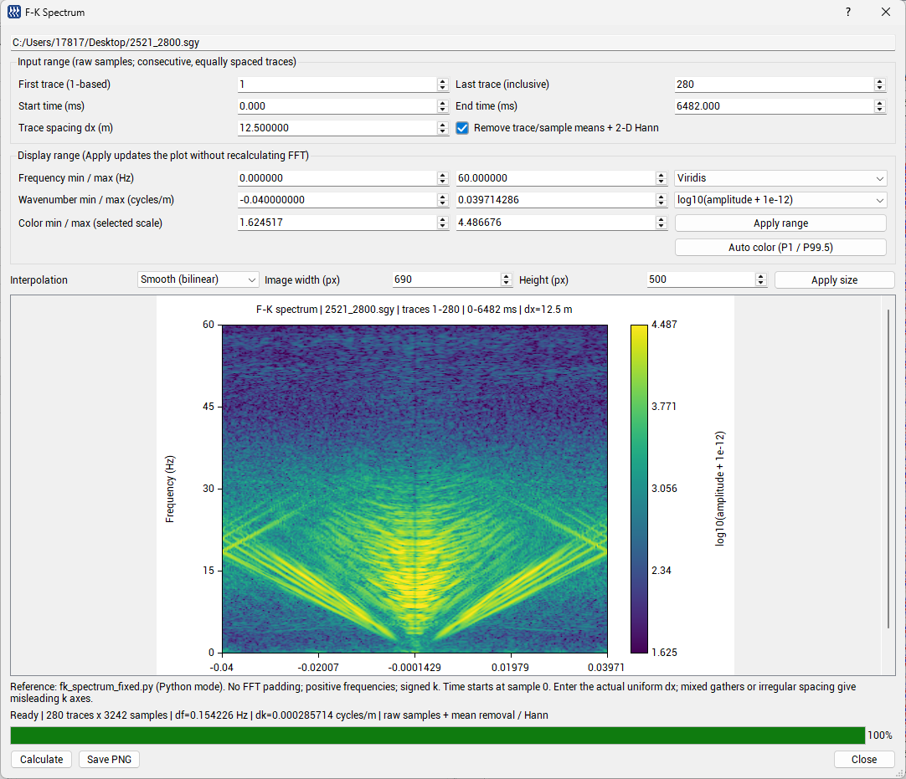

# FK 频谱功能说明

您好，在已合并的 Metrics 修改基础上，这次补充了内置 FK 频谱绘制功能，入口放在 **Tools → F-K Spectrum**，供您查看和复核。

## 功能与交互

1. **分析范围**：新开 FK 窗口时，默认使用主窗口当前可见的道范围与时间窗，支持缩放、平移及反向道排列。用户可继续手动调整；激活已打开的 FK 窗口不会覆盖已修改的参数。
2. **坐标与色标**：道间距 dx 由用户输入，频率（Hz）、波数（cycles/m）及色标幅度范围均可自定义。提供 Jet、Viridis、Inferno、Gray、RdBu，以及 log10／线性幅度显示。
3. **参数保留**：重新计算保留用户设定的频率、波数和色标范围。切换幅度尺度也保留色标数值，自动调整由 Auto color 按钮触发；新数据使坐标越界时，只作必要的边界限制。
4. **平滑显示**：默认双线性插值，减轻放大后的矩形色块，同时保留最近邻原始网格显示。插值只改变显示，不改变 FFT 数值或真实分辨率。
5. **图片尺寸与保存**：宽高独立设置，支持合法键盘输入后即时更新和 Apply size。宽高自动保存，下次开窗或重启后恢复；PNG 按指定像素尺寸保存完整图像，包含坐标与色标，不受屏幕 DPI 倍率影响。
6. **非模态与关闭联动**：主窗口可继续浏览和复制路径。后台线程独立读取文件，主窗口关闭时停止计算并关闭 FK 窗口。

## 计算实现

按既有 `fk_spectrum_fixed.py` 的默认 Python 路线实现：可选逐道／逐时间样点去均值和二维 Hann 窗，二维 FFT 后取幅度并显示正频率部分。FFT 复用现有 `libCwp/pfafft.cpp` 的 float 实现；CWP 不直接支持的长度使用基于 CWP FFT 的 Bluestein 卷积，保持原始变换长度和频率／波数网格。

计算类继续放在 `workthread.h/.cpp`，工程配置放在 `SeiSeeMp.pro`；复选框使用项目的 CustomCheckBox。主窗口的显示增益、AGC、滤波和道头延迟校正不套入此处的原始数据谱计算。

## 实际数据界面示例

以下为用户提供的 `2521_2800.sgy` 实际运行截图：280 道、3242 个样点，dx=12.5 m，显示频率 0～60 Hz，Viridis 色标，log10 幅度、双线性插值，图片尺寸 690×500 px。

## 验证与平台状态

- Windows x64 / Qt 5.15.2 / MSVC 2022 Release 构建通过。
- 100%、200% 显示缩放回归分别为 **11 项通过、0 项失败**，隔离运行库的便携环境同样通过。
- 使用原 Python 脚本生成 5 组数值基准，覆盖奇偶长度、CWP 非直接支持长度、开启／关闭预处理，逐点核对谱幅度及全部坐标。
- 回归覆盖可见范围初始化、重新计算保留显示参数、实际键盘输入尺寸与 PNG 尺寸一致、跨进程宽高恢复、非模态窗口和关闭联动。
- Linux 使用共用 Qt/CWP 源码，**尚未实际编译运行**。实际多显示器切换、大规模数据及原生文件保存对话框尚未全面验证。

详细参数与算法约定见 [FK 使用说明](fk-spectrum.md)。烦请您查看，有需要调整的地方我再继续修改。
